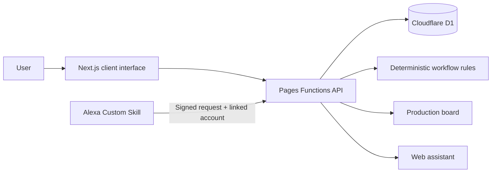

# CUE — Confirmed Updates & Execution

*Your next step, right on cue.*

CUE is a workflow-aware baking production assistant for Bookiery's solo baker. The web board uses a Cloudflare Pages Functions API and D1 database for accounts, production runs, proposals, and history. The Alexa Custom Skill uses Alexa account linking to read the same server records and requires explicit confirmation before applying a workflow update. Customer messages are drafts only and are never sent; neither the web app nor Alexa can verify what is happening in the kitchen.

> **Prototype:** this application is not yet deployed or configured with production cloud/Alexa credentials. Email addresses are not verified, password recovery is not configured, and workflow templates are not validated recipes. Use fictional records until those safeguards and workflows are reviewed.

## Product context

### Problem

Bookiery's solo baker coordinates products with different preparation sequences, batch constraints, waiting periods, quality checks, and packing steps. The baker needs to know what is recorded as done, what is waiting, what can proceed in parallel, and what still needs attention.

The project context describes that production workflow, but does not establish how often the current tracking method makes this information hard to retrieve, how burdensome that is, or whether it causes mistakes.

### Proposed solution

CUE proposes a conversational way to retrieve production status and identify work whose recorded prerequisites are complete, alongside a board showing that same recorded state. In this prototype, Alexa answers common status, next-step, wait, and blocker questions from the selected run, and can draft customer updates for the user to review. The board lets the user propose, confirm, or cancel workflow updates.

CUE coordinates **recorded workflow state**, not physical reality. A timer or recorded duration cannot establish that food has cooled, frozen, chilled, or baked sufficiently. A person remains responsible for physical readiness and quality checks.

### Opportunity gap

Notes, spreadsheets, and checklists can record production work. It remains untested whether combining conversational status lookup with dependency-aware guidance helps Bookiery's baker resume work, find eligible parallel tasks, and keep records accurate compared with the baker's existing method.

| Question | Current understanding |
| --- | --- |
| Problem | Coordinating products, dependencies, active tasks, waits, inspections, and finishing steps. The tracking burden is not measured. |
| Solution | A shared recorded state presented through rule-based status lookup and an interactive board, with confirmation for updates. |
| Opportunity gap | Whether this interaction is useful, accurate, and preferable to the baker's current tracking method. |

### Evidence and hypotheses

The supplied project brief gives general baking workflow context and refers to an available baker interview, but no interview transcript, attributable quotation, usability study, or measured outcome is included in this repository. Treat these as hypotheses: tracking is difficult or frequent; conversational guidance is better than existing tools; CUE reduces effort or mistakes; and the baker will adopt it during production.

- **Evidence available:** repository implementation and tests; general workflow context in the supplied brief.
- **Design hypotheses:** shared board/chat state, dependency-aware suggestions, and explicit confirmation may help resume work safely.
- **Outcomes to measure:** task success, incorrect transitions, time to find eligible work, and comparison with the current method.
- **Business hypotheses:** adoption, time savings, fewer errors, and commercial value are not established.

## Primary user and jobs

**Primary user:** Bookiery's solo baker, who independently handles preparation, batching, waits, quality checks, finishing, and packing.

Intended jobs:

1. Check recorded completed and outstanding work.
2. Find tasks that can proceed while another component waits.
3. See which prerequisites or human inspections prevent progress.
4. Correct an inaccurate record without implying physical work was undone.
5. Confirm required production and packing work is complete.

## MVP scope and feature status

The prototype focuses on one baker, fictional sample runs, a shared server source of recorded state, a conversational web interface, a visual board, dependency checks, update confirmation, human verification, and an Alexa Custom Skill.

| Feature | Purpose | Priority | Status | Limitation |
| --- | --- | ---: | --- | --- |
| Production board | Show runs, tasks, progress, waits, blockers, inspections, and actions | 1 | **Implemented** | D1-backed user records; product workflows are generic. |
| Alexa Custom Skill | Ask about status, eligible work, waits, blockers, and task state | 2 | **Implemented** | Skill handlers, account linking, and request verification are in code; the Alexa console and public deployment still need configuration. |
| Customer update drafts | Draft a customer-facing progress message from recorded run status and user-provided context | 3 | **Implemented** | Drafts are not sent; the demo has no customer contact details or messaging integration. Review user-provided details before sharing. |
| Dependency-aware guidance | Surface tasks with recorded prerequisites satisfied | 4 | **Implemented** | Deterministic prerequisite checks. Parallel work is only labeled when configured; there is no capacity scheduler. |
| Confirmed updates | Review a proposed run/task/state change, then confirm or cancel | 5 | **Implemented** | Server checks ownership, workflow rules, task state, and run version; stale proposals are rejected. Alexa also requires voice confirmation. |
| Waiting stages | Record waits and show reason, start time, estimate, and inspection requirement | 6 | **Partial** | No countdown, due reminder, or automatic readiness decision. |
| Corrections and quality issues | Reopen a record or report a failed inspection with a reason | 7 | **Partial** | Local demo record only; no durable audit service or operational review process. |
| Product-specific finishing | Require configured finishing and packing before completion | 8 | **Partial** | Current products share a generic sequence, not verified recipes or completion criteria. |

Deferred from this MVP: helper roles, inventory, sending customer messages, payments, predictive analytics, automatic readiness sensing, hosted AI models, email verification/password recovery, and advanced notifications. These are scope choices, not claims of technical impossibility.

## User journeys

### Current-state journey described by project context

1. Review customer orders or plan products for general sale.
2. Prepare ingredients, tools, components, and batches.
3. Work through production while managing oven capacity and parallel work.
4. Wait for cooling, freezing, chilling, or setting.
5. Use waits to prepare other components or packaging.
6. Check readiness and resume dependent work.
7. Inspect, finish, pack, store, and prepare products for sale or pickup.

This context establishes the general workflow only. It does not establish how often interruptions or tracking problems occur, their severity, or resulting mistakes.

### Proposed CUE journey

1. Choose a sample production run.
2. Ask about status, completed work, waits, blockers, or what can happen next.
3. Review eligible tasks and recorded prerequisites.
4. Perform work and choose a progress action on the board.
5. Review the affected run, task, and proposed state; confirm or cancel.
6. See a confirmed update reflected in the board and server-backed chat queries.
7. Continue eligible work or record an inspection outcome.
8. Complete configured tasks before the run reaches 100%.

This is a proposed journey demonstrated by the prototype, not validated with the intended user.

## Product workflow templates

The three named products currently use substantially the same seven-step generic template: **Prepare ingredients → Prepare main component → Cook or bake main component → Prepare packaging → Cool/chill main component → Inspect finished component → Finish and pack order.** Cheesecake changes a couple of labels and the wait reason to chilling. These are examples, not recipes or food-safety instructions.

| Product | Configured now | Missing or requires baker confirmation |
| --- | --- | --- |
| Chewy Pistachio Crunchies | Generic main-component sequence; packaging marked parallel; 45-minute cooling estimate with physical check; sample run has a freezing-process field. | Defrost kataifi, butter mixing, batch baking, cooling dependency before filling, portioning, freezing steps/duration, assembly/molding, coating, storage, stickers, overnight versus rush process, readiness criteria. |
| No-Bake Cheesecake Biscoff (displayed as “Biscoff Cheesecake”) | Generic sequence with “Prepare cheesecake filling” and a chilling wait. | Room-temperature ingredients, crust/firmness, filling dependency, portioning, assembly/toppings, setting duration, inspection criteria, packing and presentation. |
| Belgian Chocolate Chip Cookies | Generic workflow, not a cookie recipe. | Browned-butter cooling, mixing order, chocolate, weighing/portioning, overnight freezing, bake procedure/time, doneness, cooling, quality and packing. |

Wait estimates are not guaranteed times. The app displays an estimate and recorded wait start in chat; it does not calculate a due state or issue an inspection reminder. Exact process durations and readiness criteria are unconfigured.

## Workflow states and safeguards

The workflow uses these task states:

| State | Meaning in this prototype |
| --- | --- |
| NOT_STARTED | No work recorded. |
| READY | Recorded prerequisites are satisfied; may be considered for starting. |
| IN_PROGRESS | Work recorded as active. |
| WAITING | A wait has been recorded. |
| NEEDS_INSPECTION | A human inspection is recorded as needed. |
| BLOCKED | An obstacle or failed inspection is recorded. |
| COMPLETED | Task recorded complete. |

Eligibility uses completed prerequisite keys and, for freezing tasks, a selected process. The workflow validator rejects invalid transitions, prevents skipping directly from not-started to completed, and guards reopening completed work after dependents progress. Confirmation recalculates readiness. A run becomes complete only when all mandatory tasks are complete.

| Invariant | Status |
| --- | --- |
| Prerequisites must be complete before eligible progression | **Implemented** in eligibility and transition validation. |
| Chat cannot override workflow rules | **Implemented by architecture:** chat is read-only and uses the eligibility helper; no LLM exists. |
| Waiting differs from ready; elapsed time does not prove readiness | **Implemented as separate states.** No timer auto-completes a wait. Configured physical checks require a user confirmation in the UI. |
| Inspections and blockers represent human decisions | **Partial:** user can confirm inspection or report failure with a reason; no detailed checklist or independent verification. |
| Cancel leaves production state unchanged | **Implemented** and tested. |
| Corrections do not reverse physical work | **Partial:** correction changes only the record and requires a reason; no durable audit system. |
| Mandatory tasks gate run completion | **Implemented** in completion calculation; all sample tasks are mandatory. |

The board, web assistant, and Alexa skill read and update the same D1 records. The API revalidates every state transition, checks run versions when confirming proposals, scopes reads/writes to the authenticated owner, and records transition history. Sessions use opaque random tokens stored as hashes, Secure/HttpOnly cookies, CSRF tokens, and PBKDF2 password hashes. Alexa requests use the ASK SDK signature and timestamp verifiers. Local D1 is for development; no production database or skill is connected yet.

## Cloudflare deployment and static assets

The frontend remains a Next.js static export served by Cloudflare Pages. Pages Functions under [functions/](functions/) provide same-origin API routes; D1 schema changes are in [migrations/](migrations/). The Alexa SDK request verifier needs the configured `nodejs_compat` runtime. Do not use the Workers/OpenNext deployment preset. `pnpm run dev` builds the frontend, applies local D1 migrations, and starts a Pages Functions preview.

For production deployment:

1. Create a Cloudflare D1 database named `cue-production`, then set its actual `database_id` in [wrangler.jsonc](wrangler.jsonc).
2. Set `ALEXA_SKILL_ID`, `ALEXA_CLIENT_ID`, and comma-separated exact `ALEXA_REDIRECT_URIS` in the Pages environment.
3. Store `ALEXA_CLIENT_SECRET` as a Cloudflare Pages secret (`wrangler pages secret put ALEXA_CLIENT_SECRET --project-name cue`); do not commit it.
4. Run `pnpm run deploy`; the predeploy step applies remote migrations before Pages deployment.
5. In the Alexa Developer Console, create a Custom Skill, upload [alexa/interaction-model.json](alexa/interaction-model.json), set the HTTPS endpoint to `https://<your-pages-domain>/api/alexa`, and configure account-linking OAuth endpoints at `/api/oauth/authorize` and `/api/oauth/token` for authorization-code grant with PKCE.

Alexa's account-linking setup provides the redirect URI(s); allowlist those exact values in `ALEXA_REDIRECT_URIS`. Use the same Alexa client ID and secret in the console and Pages environment. This workspace has no Cloudflare account, Alexa Developer account, production database ID, or credentials, so no live deployment, console setup, or certification was possible.

All five requested images are committed under public/cue/, use root-relative URLs, and were copied to out/cue/ by the production export. Wrangler Pages local preview returned image/png and status 200 for every asset; the landing, app, sign-in, and sign-up routes also returned 200. This verifies local Pages delivery, not visibility on a live deployment.

| Asset | Browser path | Current use |
| --- | --- | --- |
| CUE logo | /cue/logo.png | Landing navigation/footer, sign-in/sign-up, app header, and chat header. |
| CUE mascot | /cue/mascot.png | Responsive landing hero; error fallback is provided. |
| clarifying.png | /cue/clarifying.png | Chat clarification response state. |
| thinking.png | /cue/thinking.png | Chat processing state. |
| success.png | /cue/success.png | Landing page workflow illustration. |

No incorrect filename casing, missing source file, or route-relative asset path was found. The logo is rendered with a regular img element, so the custom Next image loader is not involved. The original missing-image report cannot be independently reproduced without a live URL/browser console; no actual deployed rendering was confirmed in this environment.

## Architecture



- **UI and routes:** Next.js App Router pages under src/app/(frontend)/. Home renders the landing page; /auth/signin/ and /auth/signup/ render account forms; /app/ renders the board and chat.
- **Workflow:** [src/lib/workflow.ts](src/lib/workflow.ts) implements prerequisites, eligibility, readiness recalculation, transition validation, and progress.
- **State/API:** [backend/api.js](backend/api.js) handles sessions, D1-backed products/runs, proposals, web assistant queries, and OAuth account linking. [migrations/](migrations/) defines the schema and starter product templates.
- **Alexa:** [backend/skill.js](backend/skill.js) implements status, next steps, waits, blockers, customer drafts, and voice-confirmed task proposals with the ASK SDK. [alexa/interaction-model.json](alexa/interaction-model.json) contains the custom skill model.
- **Stack/build:** React 19, Next.js 16, Cloudflare Pages Functions, D1, TypeScript, and Tailwind CSS 4. [next.config.ts](next.config.ts) keeps static export; [wrangler.jsonc](wrangler.jsonc) configures the Pages D1 binding.

## Repository map

```text
src/
  app/(frontend)/       Landing, account UI, production board
  lib/                   API client, demo product data, types, workflow rules
backend/                 D1 API, OAuth, Alexa skill handlers and tests
functions/                Cloudflare Pages Function entry point
migrations/               D1 schema and product seeds
alexa/                    Alexa Custom Skill interaction model
tests/                    Workflow and compatibility test suites
scripts/dev.mjs           Build and launch local Pages Functions preview
legacy/                  Archived Payload/Figma source
.figma/make/             Figma Make lifecycle scripts
```

## Prerequisites and setup

- Node.js 20.9 or newer.
- pnpm 10.34.3, pinned in package.json and .mise.toml.

From a checkout:

```bash
pnpm install
pnpm run dev
```

The dev script builds the static site, applies local D1 migrations, and starts Wrangler Pages on `PORT` (3000 by default). Open the local URL printed by Wrangler.

Local development uses `.wrangler/` for D1 data. Alexa-specific routes remain disabled until the skill ID and OAuth client settings are configured. The layout optionally reads NEXT_PUBLIC_SITE_URL for metadata and defaults to http://localhost:3000.

## Using the demo

1. Open /auth/signin/ and choose **Try Baker Demo** for isolated fictional sample runs, or create a CUE account.
2. Select a run on the board.
3. Ask about status, next eligible work, waits, or blockers. Include a run ID or product name if needed.
4. Use task controls to propose a transition, correction, or inspection result.
5. Review the confirmation panel and confirm or cancel. Cancel does not change task state.
6. Refresh or sign in from another device to check server persistence. **Reset demo data** restores only the current demo workspace.

The web assistant uses deterministic intent matching, not a hosted model. Alexa voice access requires linking the CUE account in the Alexa app. Neither assistant sends customer messages or makes readiness decisions.

## Development commands and deployment

| Command | Purpose |
| --- | --- |
| pnpm run dev | Build the site, apply local D1 migrations, and start Pages Functions. |
| pnpm run typecheck | TypeScript check without emitting. |
| pnpm test | Run workflow, storage-compatibility, and Alexa skill tests with tsx. |
| pnpm run build | Build the Next.js static export into out/. |
| pnpm run preview | Apply local D1 migrations and serve out/ plus Pages Functions. |
| pnpm run deploy | Apply remote D1 migrations, then upload Pages (requires configured Cloudflare account/database). |
| pnpm exec wrangler d1 migrations apply cue-production --local | Apply D1 schema locally. |
| pnpm run format | Run Oxfmt. |

CUE serves static Next.js pages alongside Cloudflare Pages Functions. The API and Alexa endpoint run on the Pages Workers runtime and use a D1 database binding.

Create the Pages project `cue` and D1 database `cue-production` before remote migrations. Update the placeholder `database_id` in wrangler.jsonc with the real D1 ID. Configure the Pages variables and secret above before enabling Alexa account linking. Do not deploy with the placeholder database ID or empty skill configuration.

## Tests and acceptance criteria

Workflow tests are in [tests/workflow.test.mjs](tests/workflow.test.mjs); Alexa request/confirmation behavior is covered in [backend/tests/alexa-skill.test.mjs](backend/tests/alexa-skill.test.mjs). The API and persistence were also exercised through the local Pages/D1 runtime.

| Scenario | Expected behavior | Verification |
| --- | --- | --- |
| Unmet prerequisite | Task is ineligible and invalid progression is rejected | Transition rejection covered; add direct eligibility test. |
| Multiple eligible tasks during wait | All eligible tasks surfaced; configured parallel work labeled | Logic exists; add dedicated test. |
| Wait estimate elapsed | No automatic completion; configured human check remains necessary | No timer exists; add UI test. |
| Propose, confirm, cancel | Confirm applies update; cancel leaves run unchanged | Local Pages/D1 smoke test and Alexa handler tests. |
| Stale proposal | Changed run version/state prevents applying old proposal | Version-checked in API; integration coverage should be expanded. |
| Board and chat consistency | Both reflect the same server records | Browser preview smoke test. |
| Corrections, failed inspection, completion gating | Reasoned record changes; mandatory tasks gate completion | Some guards/UI exist; automated edge coverage incomplete. |
| Persistence and malformed/blocked storage | Valid records survive reload; database failures return errors | Local D1 smoke test; add failure-injection coverage. |
| Empty state, unsupported question, missing/ambiguous run | Helpful prompt or clarification | UI logic exists; add browser tests. |

Run checks:

```bash
pnpm run typecheck
pnpm test
pnpm run build
```

Passing tests demonstrate code behavior, not baker usability or product outcomes. The static Cloudflare Pages preview is served with Wrangler and has no Worker server bundle to validate.

## Limitations, risks, and next steps

- CUE records input; it cannot observe food, equipment, or kitchen conditions.
- Recommendations depend on complete templates and accurate user input. Product steps and readiness criteria remain incomplete.
- The web assistant is scripted keyword lookup, not an LLM. The Alexa skill uses configured intents and requires an Alexa Developer Console setup.
- Email verification, password-reset delivery, and account recovery are not implemented. Do not treat an unverified email address as proof of identity or store real customer data.
- The production Cloudflare database, Pages environment, Alexa skill, and credentials have not been created or deployed from this checkout.
- A working demo does not establish usability, safety, adoption, time savings, or fewer errors.

Recommended order:

1. Observe how the baker tracks production and identify concrete retrieval or coordination difficulties.
2. Confirm product sequences, parallel work, wait processes, durations, inspections, and completion criteria.
3. Test realistic status and dependency scenarios against the current method.
4. Measure task success, invalid transitions, and time to find eligible work; record method and findings.
5. Ask the baker to compare CUE with the current process; report feedback without overstatement.
6. Add tests for unmet prerequisites, multiple eligible tasks, stale proposals, failed inspections, corrections, and completion gating.
7. Before real customer data, add verified-email onboarding and a password-reset provider; review and validate product recipes and readiness criteria.
8. Create the production D1 database and Pages/Alexa environments, configure account linking, then validate the skill end-to-end in the Alexa simulator before certification.

## Development notes and license

Keep workflow enforcement deterministic and independent of conversational phrasing. A future language model should interpret requests only and must not decide eligibility or bypass transition validation. Keep physical-readiness boundaries explicit.

No license file or contribution guide was found in the inspected repository. Confirm licensing and contribution terms before external reuse.
