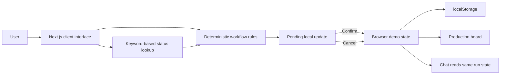

# CUE — Confirmed Updates & Execution

*Your next step, right on cue.*

CUE is a workflow-aware baking production assistant prototype for Bookiery's solo baker. This repository contains a browser-only demonstration: a rule-based conversational status panel and production board read and update the same local sample records. It demonstrates recorded task dependencies and confirmed changes; it does not verify what is happening in the kitchen.

> **Prototype:** data is stored in the current browser profile. Sign-in and sign-up are local demonstrations, not secure authentication. Do not enter real customer data or reuse a real password.

## Product context

### Problem

Bookiery's solo baker coordinates products with different preparation sequences, batch constraints, waiting periods, quality checks, and packing steps. The baker needs to know what is recorded as done, what is waiting, what can proceed in parallel, and what still needs attention.

The project context describes that production workflow, but does not establish how often the current tracking method makes this information hard to retrieve, how burdensome that is, or whether it causes mistakes.

### Proposed solution

CUE proposes a conversational way to retrieve production status and identify work whose recorded prerequisites are complete, alongside a board showing that same recorded state. In this prototype, the chat recognizes a small set of status questions and the board lets the user propose, confirm, or cancel workflow updates.

CUE coordinates **recorded workflow state**, not physical reality. A timer or recorded duration cannot establish that food has cooled, frozen, chilled, or baked sufficiently. A person remains responsible for physical readiness and quality checks.

### Opportunity gap

Notes, spreadsheets, and checklists can record production work. It remains untested whether combining conversational status lookup with dependency-aware guidance helps Bookiery's baker resume work, find eligible parallel tasks, and keep records accurate compared with the baker's existing method.

| Question | Current understanding |
| --- | --- |
| Problem | Coordinating products, dependencies, active tasks, waits, inspections, and finishing steps. The tracking burden is not measured. |
| Solution | A shared recorded state presented through rule-based status lookup and an interactive board, with confirmation for updates. |
| Opportunity gap | Whether this interaction is useful, accurate, and preferable to the baker's current tracking method. |

### Evidence and hypotheses

The supplied project brief gives general baking workflow context and refers to an available baker interview, but no interview transcript, attributable quotation, usability study, or measured outcome is included in this repository. Treat these as hypotheses: tracking is difficult or frequent; conversational guidance is better than existing tools; CUE reduces effort or mistakes; and the baker will adopt it during production.

- **Evidence available:** repository implementation and tests; general workflow context in the supplied brief.
- **Design hypotheses:** shared board/chat state, dependency-aware suggestions, and explicit confirmation may help resume work safely.
- **Outcomes to measure:** task success, incorrect transitions, time to find eligible work, and comparison with the current method.
- **Business hypotheses:** adoption, time savings, fewer errors, and commercial value are not established.

## Primary user and jobs

**Primary user:** Bookiery's solo baker, who independently handles preparation, batching, waits, quality checks, finishing, and packing.

Intended jobs:

1. Check recorded completed and outstanding work.
2. Find tasks that can proceed while another component waits.
3. See which prerequisites or human inspections prevent progress.
4. Correct an inaccurate record without implying physical work was undone.
5. Confirm required production and packing work is complete.

## MVP scope and feature status

The prototype focuses on one baker, fictional sample runs, one local source of recorded state, a simulated conversational web interface, a visual board, dependency checks, update confirmation, and human verification.

| Feature | Purpose | Priority | Status | Limitation |
| --- | --- | ---: | --- | --- |
| Production board | Show runs, tasks, progress, waits, blockers, inspections, and actions | 1 | **Implemented** | Browser-local sample data; product workflows are generic. |
| Conversational status lookup | Ask about status, eligible work, waits, or blockers | 2 | **Partial** | Deterministic keyword matching and fixed response patterns; no LLM, voice assistant, or unrestricted conversation. |
| Dependency-aware guidance | Surface tasks with recorded prerequisites satisfied | 3 | **Implemented** | Deterministic prerequisite checks. Parallel work is only labeled when configured; there is no capacity scheduler. |
| Confirmed updates | Review a proposed run/task/state change, then confirm or cancel | 4 | **Implemented** | Proposal captures run version and expected task state; stale proposals are rejected. Client-side demo logic is not a security boundary. |
| Waiting stages | Record waits and show reason, start time, estimate, and inspection requirement | 5 | **Partial** | No countdown, due reminder, or automatic readiness decision. |
| Corrections and quality issues | Reopen a record or report a failed inspection with a reason | 6 | **Partial** | Local demo record only; no durable audit service or operational review process. |
| Product-specific finishing | Require configured finishing and packing before completion | 7 | **Partial** | Current products share a generic sequence, not verified recipes or completion criteria. |

Deferred from this MVP: helper accounts, multi-user sync, inventory, customer messaging, payments, predictive analytics, automatic readiness sensing, Alexa+ hardware, and advanced notifications. These are scope choices, not claims of technical impossibility.

## User journeys

### Current-state journey described by project context

1. Review customer orders or plan products for general sale.
2. Prepare ingredients, tools, components, and batches.
3. Work through production while managing oven capacity and parallel work.
4. Wait for cooling, freezing, chilling, or setting.
5. Use waits to prepare other components or packaging.
6. Check readiness and resume dependent work.
7. Inspect, finish, pack, store, and prepare products for sale or pickup.

This context establishes the general workflow only. It does not establish how often interruptions or tracking problems occur, their severity, or resulting mistakes.

### Proposed CUE journey

1. Choose a sample production run.
2. Ask about status, completed work, waits, blockers, or what can happen next.
3. Review eligible tasks and recorded prerequisites.
4. Perform work and choose a progress action on the board.
5. Review the affected run, task, and proposed state; confirm or cancel.
6. See a confirmed update reflected in the board and local chat queries.
7. Continue eligible work or record an inspection outcome.
8. Complete configured tasks before the run reaches 100%.

This is a proposed journey demonstrated by the prototype, not validated with the intended user.

## Product workflow templates

The three named products currently use substantially the same seven-step generic template: **Prepare ingredients → Prepare main component → Cook or bake main component → Prepare packaging → Cool/chill main component → Inspect finished component → Finish and pack order.** Cheesecake changes a couple of labels and the wait reason to chilling. These are examples, not recipes or food-safety instructions.

| Product | Configured now | Missing or requires baker confirmation |
| --- | --- | --- |
| Chewy Pistachio Crunchies | Generic main-component sequence; packaging marked parallel; 45-minute cooling estimate with physical check; sample run has a freezing-process field. | Defrost kataifi, butter mixing, batch baking, cooling dependency before filling, portioning, freezing steps/duration, assembly/molding, coating, storage, stickers, overnight versus rush process, readiness criteria. |
| No-Bake Cheesecake Biscoff (displayed as “Biscoff Cheesecake”) | Generic sequence with “Prepare cheesecake filling” and a chilling wait. | Room-temperature ingredients, crust/firmness, filling dependency, portioning, assembly/toppings, setting duration, inspection criteria, packing and presentation. |
| Belgian Chocolate Chip Cookies | Generic workflow, not a cookie recipe. | Browned-butter cooling, mixing order, chocolate, weighing/portioning, overnight freezing, bake procedure/time, doneness, cooling, quality and packing. |

Wait estimates are not guaranteed times. The app displays an estimate and recorded wait start in chat; it does not calculate a due state or issue an inspection reminder. Exact process durations and readiness criteria are unconfigured.

## Workflow states and safeguards

The workflow uses these task states:

| State | Meaning in this prototype |
| --- | --- |
| NOT_STARTED | No work recorded. |
| READY | Recorded prerequisites are satisfied; may be considered for starting. |
| IN_PROGRESS | Work recorded as active. |
| WAITING | A wait has been recorded. |
| NEEDS_INSPECTION | A human inspection is recorded as needed. |
| BLOCKED | An obstacle or failed inspection is recorded. |
| COMPLETED | Task recorded complete. |

Eligibility uses completed prerequisite keys and, for freezing tasks, a selected process. The workflow validator rejects invalid transitions, prevents skipping directly from not-started to completed, and guards reopening completed work after dependents progress. Confirmation recalculates readiness. A run becomes complete only when all mandatory tasks are complete.

| Invariant | Status |
| --- | --- |
| Prerequisites must be complete before eligible progression | **Implemented** in eligibility and transition validation. |
| Chat cannot override workflow rules | **Implemented by architecture:** chat is read-only and uses the eligibility helper; no LLM exists. |
| Waiting differs from ready; elapsed time does not prove readiness | **Implemented as separate states.** No timer auto-completes a wait. Configured physical checks require a user confirmation in the UI. |
| Inspections and blockers represent human decisions | **Partial:** user can confirm inspection or report failure with a reason; no detailed checklist or independent verification. |
| Cancel leaves production state unchanged | **Implemented** and tested. |
| Corrections do not reverse physical work | **Partial:** correction changes only the record and requires a reason; no durable audit system. |
| Mandatory tasks gate run completion | **Implemented** in completion calculation; all sample tasks are mandatory. |

The board and chat use the same in-memory store within the page. A confirmed proposal updates the run and emits state changes, so both read the same state. Local storage restores the state after refresh in that browser profile. No multi-device or multi-user sync exists; independent tabs are not a supported shared-state service.

## Cloudflare deployment and static assets

The previous deployment log shows a Workers/OpenNext packaging step looking for .next/standalone/.next/server/pages-manifest.json. This repository sets output: export in next.config.ts. Next.js static export produces the out/ directory; it does not create the standalone server bundle that the OpenNext adapter expects. The local build also confirmed that the standalone manifest path is absent, while .next/server/pages-manifest.json and the static out/ tree exist. Therefore, the reported ENOENT follows from sending a static export through the OpenNext/Worker packaging workflow. The log's Next.js 16.4.0 peer warning is a second mismatch for that adapter version (its stated range starts at 16.4.1); no OpenNext dependency is needed for the selected static architecture.

Use Cloudflare Pages with the Next.js Static HTML Export preset: build command pnpm run build, output directory out. Do not run pnpm opennextjs-cloudflare build or npx wrangler deploy. For direct Pages CLI deployment, run pnpm run build, then pnpm run deploy. Wrangler's committed configuration points Pages at out/ and names the project cue. The output/export model is supported by [Next.js static export](https://nextjs.org/docs/app/guides/static-exports), and Cloudflare documents the [Pages static Next.js workflow](https://developers.cloudflare.com/pages/framework-guides/nextjs/deploy-a-static-nextjs-site/). The account's current project type/name still has to be checked in Cloudflare; this workspace cannot change dashboard settings or confirm a live deployment.

All five requested images are committed under public/cue/, use root-relative URLs, and were copied to out/cue/ by the production export. Wrangler Pages local preview returned image/png and status 200 for every asset; the landing, app, sign-in, and sign-up routes also returned 200. This verifies local Pages delivery, not visibility on a live deployment.

| Asset | Browser path | Current use |
| --- | --- | --- |
| CUE logo | /cue/logo.png | Landing navigation/footer, sign-in/sign-up, app header, and chat header. |
| CUE mascot | /cue/mascot.png | Responsive landing hero; error fallback is provided. |
| clarifying.png | /cue/clarifying.png | Chat clarification response state. |
| thinking.png | /cue/thinking.png | Chat processing state. |
| success.png | /cue/success.png | Landing page workflow illustration. |

No incorrect filename casing, missing source file, or route-relative asset path was found. The logo is rendered with a regular img element, so the custom Next image loader is not involved. The original missing-image report cannot be independently reproduced without a live URL/browser console; no actual deployed rendering was confirmed in this environment.

## Architecture



- **UI and routes:** Next.js App Router pages under src/app/(frontend)/. Home renders the landing page; /auth/signin/ and /auth/signup/ render local demo forms; /app/ renders the board and chat.
- **Workflow:** [src/lib/workflow.ts](src/lib/workflow.ts) implements prerequisites, eligibility, readiness recalculation, transition validation, and progress.
- **State:** [src/lib/demo-storage.ts](src/lib/demo-storage.ts) owns the client store, localStorage, demo accounts, runs, and pending updates. [src/lib/demo-data.ts](src/lib/demo-data.ts) contains fictional products and sample runs.
- **Conversation:** CueChat in [DashboardClient.tsx](src/app/%28frontend%29/app/DashboardClient.tsx) uses keyword checks and fixed response patterns. No API, model, backend, or Alexa+ integration is present.
- **Backend:** no active Payload, database, server action, or application API is used. Previous Payload/Figma source is retained under legacy/ for reference.
- **Stack/build:** React 19, Next.js 16, TypeScript, Tailwind CSS 4. [next.config.ts](next.config.ts) sets static export and trailing slashes. [figma-image-loader.ts](figma-image-loader.ts) is retained for the project environment.

## Repository map

```text
src/
  app/(frontend)/       Landing, local auth demo, production board
  components/            Landing page
  lib/                   Demo data, browser storage, types, workflow rules
tests/                   Node test suites
scripts/dev.mjs          Next dev launcher; honors PORT
legacy/                  Archived Payload/Figma source
.figma/make/             Figma Make lifecycle scripts
```

## Prerequisites and setup

- Node.js 20.9 or newer.
- pnpm 10.34.3, pinned in package.json and .mise.toml.

From a checkout:

```bash
pnpm install
pnpm run dev
```

The dev script uses PORT if set, otherwise port 3000. Open the URL printed by Next.js.

No application secrets or Payload environment variables are required for this browser demo. The layout optionally reads NEXT_PUBLIC_SITE_URL for metadata and defaults to http://localhost:3000. Figma Make lifecycle scripts are intended for their supported Make environment.

## Using the demo

1. Open /auth/signin/ and choose **Try Baker Demo** for fictional sample runs, or create a local demo account.
2. Select a run on the board.
3. Ask about status, next eligible work, waits, or blockers. Include a run ID or product name if needed.
4. Use task controls to propose a transition, correction, or inspection result.
5. Review the confirmation panel and confirm or cancel. Cancel does not change task state.
6. Refresh to check local persistence. **Reset demo data** restores the sample runs.

Chat is keyword-driven, not free-form AI. Sign-up credentials are stored in plain text in localStorage: use throwaway credentials only. Clearing browser storage removes the local data.

## Development commands and deployment

| Command | Purpose |
| --- | --- |
| pnpm run dev | Start Next.js development server. |
| pnpm run typecheck | TypeScript check without emitting. |
| pnpm test | Run Node's built-in test runner over tests/*.test.mjs. |
| pnpm run build | Build the Next.js static export into out/. |
| pnpm run preview | Serve out/ through Wrangler Pages local preview (build first). |
| pnpm run deploy | Upload out/ as a Cloudflare Pages deployment (build first). |
| pnpm run format | Run Oxfmt. |

CUE is a static-export app: its pages use browser-side state and require no Next.js server runtime. Cloudflare Workers/OpenNext is not the deployment target. The committed wrangler.jsonc identifies a Pages project named cue and the out/ directory. Wrangler is pinned in the pnpm lockfile; there is no OpenNext adapter dependency or Worker bundle.

For local verification, run pnpm run build, then pnpm run preview. For a direct upload, authenticate Wrangler with Cloudflare and run pnpm run deploy after the build. The Cloudflare Pages project slug must be cue to match wrangler.jsonc; if the existing Pages project uses another slug, update name in that file to the actual project name.

For Cloudflare Pages Git integration, select the Next.js (Static HTML Export) preset, use pnpm run build as the build command, and out as the build output directory. Pages performs the deployment after building; do not configure a separate Workers deploy command. The reported npx wrangler deploy command targets Workers and triggers framework auto-configuration. Change the Cloudflare project/workflow to Pages; code changes cannot convert an existing Workers project in the dashboard. The Wrangler Pages project lookup exited abnormally in this workspace, so no live account settings or deployment could be verified.

## Tests and acceptance criteria

Existing tests are in [tests/workflow.test.mjs](tests/workflow.test.mjs) and [tests/demo-storage.test.mjs](tests/demo-storage.test.mjs). Workflow tests cover readiness recalculation, requiring a selected process for freezing work, rejecting a skipped transition, preventing a risky reopen, and requiring a waiting stage before completing a configured wait. Storage tests cover sample initialization, confirming/persisting an update, local account validation/sign-in, run creation and cancellation without mutation, reset, blocked storage writes, and malformed stored data.

| Scenario | Expected behavior | Verification |
| --- | --- | --- |
| Unmet prerequisite | Task is ineligible and invalid progression is rejected | Transition rejection covered; add direct eligibility test. |
| Multiple eligible tasks during wait | All eligible tasks surfaced; configured parallel work labeled | Logic exists; add dedicated test. |
| Wait estimate elapsed | No automatic completion; configured human check remains necessary | No timer exists; add UI test. |
| Propose, confirm, cancel | Confirm applies update; cancel leaves run unchanged | Confirm and cancel covered by storage tests. |
| Stale proposal | Changed run version/state prevents applying old proposal | Implemented; add test. |
| Board and chat consistency | Both reflect shared current browser state | Shared store in source; add browser test. |
| Corrections, failed inspection, completion gating | Reasoned record changes; mandatory tasks gate completion | Some guards/UI exist; automated edge coverage incomplete. |
| Persistence and malformed/blocked storage | Valid data restores; demo remains usable if writes fail | Covered by storage tests. |
| Empty state, unsupported question, missing/ambiguous run | Helpful prompt or clarification | UI logic exists; add browser tests. |

Run checks:

```bash
pnpm run typecheck
pnpm test
pnpm run build
```

Passing tests demonstrate code behavior, not baker usability or product outcomes. The static Cloudflare Pages preview is served with Wrangler and has no Worker server bundle to validate.

## Limitations, risks, and next steps

- CUE records input; it cannot observe food, equipment, or kitchen conditions.
- Recommendations depend on complete templates and accurate user input. Product steps and readiness criteria remain incomplete.
- Conversation is scripted keyword lookup, not natural language, an LLM, or voice.
- Browser storage is user-editable and isolated to a browser profile. Local accounts are not authentication or access control, and passwords are stored in plain text.
- There is no server database, production API, sync, backup, customer-order integration, or verified hosted deployment.
- A working demo does not establish usability, safety, adoption, time savings, or fewer errors.

Recommended order:

1. Observe how the baker tracks production and identify concrete retrieval or coordination difficulties.
2. Confirm product sequences, parallel work, wait processes, durations, inspections, and completion criteria.
3. Test realistic status and dependency scenarios against the current method.
4. Measure task success, invalid transitions, and time to find eligible work; record method and findings.
5. Ask the baker to compare CUE with the current process; report feedback without overstatement.
6. Add tests for unmet prerequisites, multiple eligible tasks, stale proposals, failed inspections, corrections, and completion gating.
7. After workflow validation, decide whether secure accounts, server persistence, synchronization, reminders, or voice are needed.

## Development notes and license

Keep workflow enforcement deterministic and independent of conversational phrasing. A future language model should interpret requests only and must not decide eligibility or bypass transition validation. Keep physical-readiness boundaries explicit.

No license file or contribution guide was found in the inspected repository. Confirm licensing and contribution terms before external reuse.
